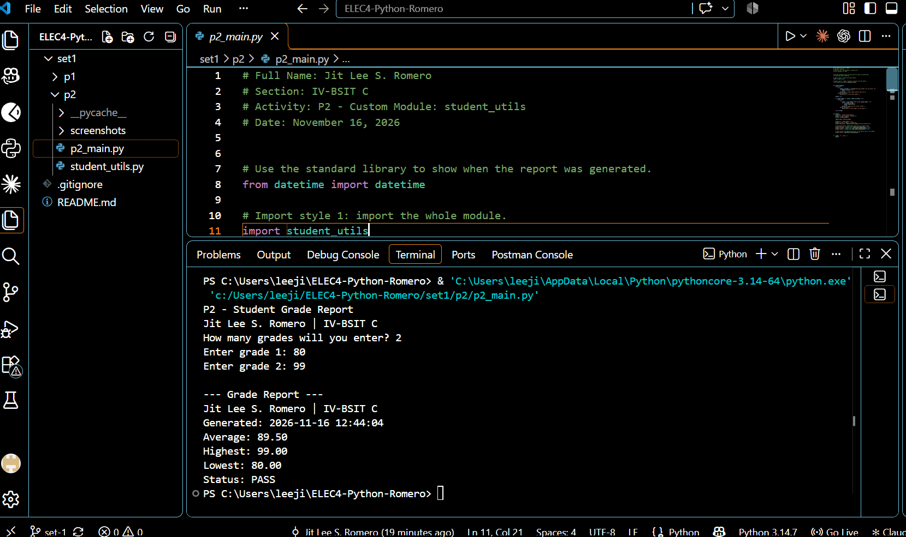
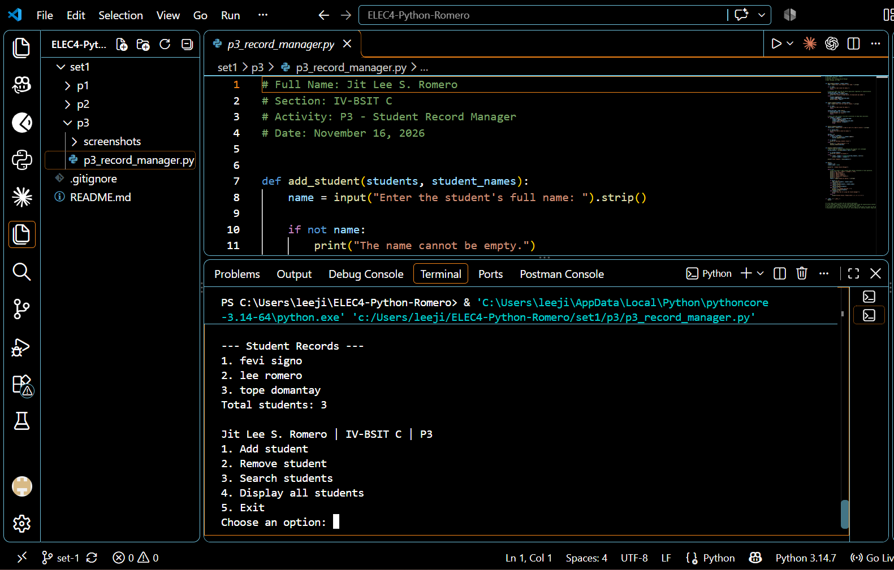
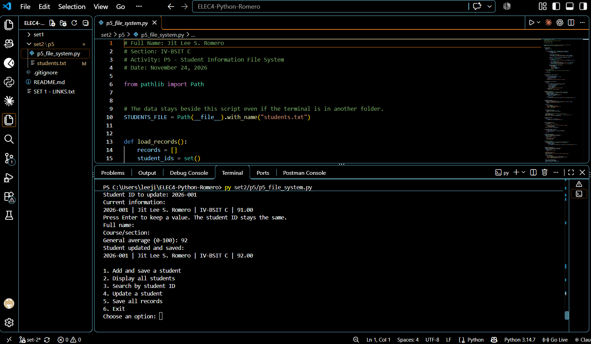
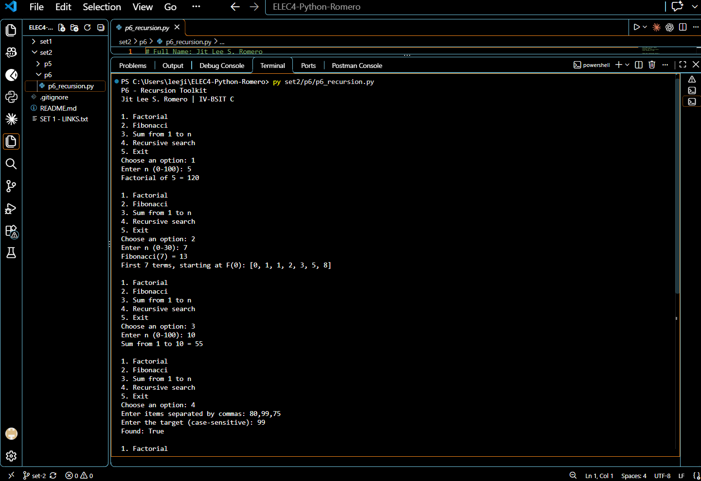

# ELEC 4 - Python Programming

- **Full name:** Jit Lee S. Romero
- **Section:** IV-BSIT C
- **Course:** ELEC 4 - Python Programming

## Set 1 Activities

| Activity | Description | Folder |
| --- | --- | --- |
| P1 - Student Grade Calculator | A menu-driven program that validates grades and uses functions to return the average, highest grade, lowest grade, and pass/fail status. | [set1/p1](set1/p1/) |
| P2 - Custom Module: student_utils | A grade report that imports four reusable functions from a custom module, demonstrates two import styles, and uses datetime to show when the report was generated. | [set1/p2](set1/p2/) |
| P3 - Student Record Manager | A menu-driven name manager that uses a list and set to prevent duplicates, search partial names, remove students, and display numbered names alphabetically with a total count. | [set1/p3](set1/p3/) |
| P4 - Safe Menu Program | A menu-driven program that uses try, except, else, and finally to handle invalid numbers, division by zero, and file-opening errors. | [set1/p4](set1/p4/) |

## How to Run P1

Python 3 is required. No additional packages are needed.
Open a terminal in the repository's root folder and run:

```sh
python set1/p1/p1_grade_calculator.py
```

For the Python installation on this computer, use this PowerShell command:

```powershell
& "$env:LOCALAPPDATA\Python\pythoncore-3.14-64\python.exe" .\set1\p1\p1_grade_calculator.py
```

1. Choose **1 - Enter grades** and enter the number of grades.
2. Enter each grade. Grades must be numeric values from 0 to 100; invalid entries are requested again.
3. Choose **2 - View results** to display the average, highest, lowest, and pass/fail status. The passing average is 75.
4. Choose **3 - Exit** to end the program.

The menu continues until Exit is selected. Choosing Enter grades again replaces the previous grades.

## P1 Sample Run and Screenshots

The screenshots show two grades, **80** and **99**, with these results:

```text
Jit Lee S. Romero | IV-BSIT C
Average: 89.50
Highest: 99.00
Lowest: 80.00
Status: PASS
```


Additional screenshots:

- [Menu options](set1/p1/screenshots/P1_options.png)
- [Entering grades](set1/p1/screenshots/P1_entering_grades.png)

The explanation of local and global variables is in the comment at the bottom of [p1_grade_calculator.py](set1/p1/p1_grade_calculator.py).

## How to Run P2

Keep [student_utils.py](set1/p2/student_utils.py) and [p2_main.py](set1/p2/p2_main.py) in the same folder.
From the repository's root folder, run:

```sh
python set1/p2/p2_main.py
```

For the Python installation on this computer, use this PowerShell command:

```powershell
& "$env:LOCALAPPDATA\Python\pythoncore-3.14-64\python.exe" .\set1\p2\p2_main.py
```

Enter the number of grades, then enter each grade. The program prints one report and ends.
For grades **80** and **99**, the results are an average of **89.50**, a highest grade of **99.00**, a lowest grade of **80.00**, and **PASS**.
The report also displays the student's name and the date and time it was generated.

The main program uses `import student_utils` to call three functions with the module name, and `from student_utils import determine_status` to call the status function directly.
It uses `from datetime import datetime` from the standard library for the report timestamp.

### P2 Screenshot

The screenshot shows the student's name, report timestamp, and the results for grades **80** and **99**.



## How to Run P3

From the repository's root folder, run:

```sh
python set1/p3/p3_record_manager.py
```

For the Python installation on this computer, use this PowerShell command:

```powershell
& "$env:LOCALAPPDATA\Python\pythoncore-3.14-64\python.exe" .\set1\p3\p3_record_manager.py
```

| Menu option | Action |
| --- | --- |
| 1 - Add student | Enter a full name. A name already present is rejected even if its capitalization differs. |
| 2 - Remove student | Enter the full name to remove. Matching ignores capitalization. |
| 3 - Search students | Enter a full name or part of a name, such as `cruz` to find `Juan Cruz`. |
| 4 - Display all students | Show the names alphabetically, numbered, with the total count. |
| 5 - Exit | End the program. |

Names are kept in memory for the current run. The list starts empty when the program is restarted.
The list/set explanation is in the five-sentence comment at the bottom of [p3_record_manager.py](set1/p3/p3_record_manager.py).

### P3 Screenshots

The five screenshots show adding a student, rejecting a duplicate, searching for a student, removing a student, and displaying all students. The author's name is visible in each screenshot.

The display shows three students in alphabetical order, numbered, with the total count:



Additional screenshots:

- [Adding a student](set1/p3/screenshots/P3_added.png)
- [Preventing a duplicate entry](set1/p3/screenshots/P3_duplicate_prevention.png)
- [Searching for a student by full name](set1/p3/screenshots/P3_search.png)
- [Removing a student](set1/p3/screenshots/P3_removed.png)

## How to Run P4

From the repository's root folder, run:

```sh
python set1/p4/p4_exceptions.py
```

For the Python installation on this computer, use this PowerShell command:

```powershell
& "$env:LOCALAPPDATA\Python\pythoncore-3.14-64\python.exe" .\set1\p4\p4_exceptions.py
```

| Menu option | Action |
| --- | --- |
| 1 - Divide two numbers | Enter two numbers. Invalid numeric input and division by zero show an error message. |
| 2 - Open a text file | Enter a file name or path. The contents are displayed if the file can be read. |
| 3 - Exit | End the program. |

The menu returns after each operation or invalid selection.
When running from the repository root, enter `README.md` in option 2 to try reading an existing text file.

In [p4_exceptions.py](set1/p4/p4_exceptions.py), `try` attempts an operation, `except` handles its errors, `else` displays the successful result, and `finally` prints a completion message whether the operation succeeded or failed.
The program catches `ValueError`, `ZeroDivisionError`, and `FileNotFoundError`, along with other file-opening and text-decoding errors.

### P4 Screenshots

The four screenshots show the required error cases and the program returning to the menu. The author's name is visible in each screenshot.

| Error case | Example inputs, entered one at a time | Screenshot |
| --- | --- | --- |
| Invalid number | Choose `1`, then enter `abc`. | [Invalid numeric input](set1/p4/screenshots/P4_invalid_input.png) |
| Division by zero | Choose `1`, then enter `10` and `0`. | [Division by zero](set1/p4/screenshots/P4_cannot_divide_zero.png) |
| Missing file | Choose `2`, then enter `missing_p4_file.text` (a file that does not exist). | [Missing file](set1/p4/screenshots/P4_missing_file.png) |
| Invalid menu choice | Enter `9` at the menu. | [Invalid menu choice](set1/p4/screenshots/P4_invalid_choice.png) |


## Set 2 Activities

| Activity | Description | Folder |
| --- | --- | --- |
| P5 - Student Information File System | A menu-driven student record system that loads, adds, displays, searches, and updates records stored in a text file. | [set2/p5](set2/p5/) |
| P6 - Recursion Toolkit | Four recursive functions for factorial, Fibonacci, summation, and list search, with input validation and documented base cases. | [set2/p6](set2/p6/) |
| P7 - Student Management System with Classes | Three related classes demonstrate student objects, private-average validation, updates, and a section roster linked to a subject. | [set2/p7](set2/p7/) |
| P8 - Inheritance and Polymorphism | Person, Student, and Teacher demonstrate inheritance, parent initialization, method overriding, and polymorphism through one list. | [set2/p8](set2/p8/) |

## How to Run P5

From the repository root, run:

```sh
python set2/p5/p5_file_system.py
```

On this Windows computer, the short command is:

```powershell
py set2/p5/p5_file_system.py
```

| Menu option | Action |
| --- | --- |
| 1 - Add and save a student | Enter a unique student ID, full name, course/section, and a numeric average from 0 to 100. The record is appended to the file. |
| 2 - Display all students | Display every record with the total count. |
| 3 - Search by student ID | Find a student using the complete ID; matching ignores capitalization. |
| 4 - Update a student | Enter the student ID, then the new name, section, and average. Press Enter to keep a value. The ID stays unchanged, and the update is saved immediately. |
| 5 - Save all records | Rewrite the file with all current records. |
| 6 - Exit | Close the program. Saved records remain available on the next run. |

[students.txt](set2/p5/students.txt) is stored beside the Python source file, regardless of the terminal's working folder. Each line contains `student ID|full name|course/section|general average`. The file currently contains five sample records.

The program starts with an empty list when the file does not exist. It rejects blank fields, the `|` separator inside a field, duplicate IDs, and invalid averages. A damaged or unreadable file is reported without being silently replaced. File reading, appending, and rewriting all use `with open(...)`.

### P5 Screenshots

The sample run searches for `2026-001`, then changes the average from **91.00** to **92.00** while retaining the name and section.



Additional screenshots:

- [Saved records](set2/p5/screenshots/P5_saved.png)
- [Records after reopening the program](set2/p5/screenshots/P5_reopened.png)
- [Search by student ID](set2/p5/screenshots/P5_search.png)

## How to Run P6

From the repository root, run:

```sh
python set2/p6/p6_recursion.py
```

On this Windows computer:

```powershell
py set2/p6/p6_recursion.py
```

| Menu option | Example inputs, entered one at a time | Result |
| --- | --- | --- |
| 1 - Factorial | Choose `1`, then enter `5`. | `Factorial of 5 = 120` |
| 2 - Fibonacci | Choose `2`, then enter `7`. | `Fibonacci(7) = 13`, with the first seven terms `[0, 1, 1, 2, 3, 5, 8]`. |
| 3 - Sum from 1 to n | Choose `3`, then enter `10`. | `Sum from 1 to 10 = 55` |
| 4 - Recursive search | Choose `4`, enter `80,99,75`, then enter target `99`. | `Found: True` |
| 5 - Exit | Choose `5`. | Close the toolkit. |

Fibonacci uses `F(0) = 0` and `F(1) = 1`. Its first `n` terms start at `F(0)` and end at `F(n-1)`, so the separately displayed `F(7)` is not part of the first seven terms.

The program accepts whole numbers from 0 to 100 for factorial and sum, and from 0 to 30 for Fibonacci. Search accepts up to 100 comma-separated text items and matches the target exactly, including capitalization. Invalid menu selections and numeric inputs show a message and allow another attempt.

All four computing functions use recursive calls without loops. Comments above each function identify its base case and recursive call. The loop used to display Fibonacci terms is outside the recursive functions.

### P6 Screenshot

The screenshot shows the author's name and sample runs of all four functions:



## How to Run P7

From the repository root, run:

```sh
python set2/p7/p7_classes.py
```

On this Windows computer:

```powershell
py set2/p7/p7_classes.py
```

The demonstration runs automatically; no input is required.

- `Student` stores the ID and name, displays information, and updates the name and average. Its private `__average` is read through `get_average()` and changed through `set_average()`, which accepts only numeric values from 0 to 100.
- `Subject` stores the subject code and title.
- `Section` holds a `Subject` object and a list of `Student` objects, then displays the section, subject, students, and total count.

The program creates three students in **IV-BSIT C** for **ELEC4 - Python Programming**. It displays them before and after updating Jit Lee S. Romero's average from **80.00** to **92.00**. An attempted average of **110** is rejected, leaving the valid average unchanged. Juan Cruz remains at **85.00** and Maria Santos at **90.00**.

The objects exist in memory for the demonstration and are recreated each time the program runs.

### P7 Screenshot

The screenshot shows the author's name, all three students before and after the update, their section and subject, the total count, and the rejected invalid average:


## How to Run P8

From the repository root, run:

```sh
python set2/p8/p8_inheritance.py
```

On this Windows computer:

```powershell
py set2/p8/p8_inheritance.py
```

The demonstration runs automatically; no input is required. `Person` stores the common name and age. `Student` adds a section, while `Teacher` adds a subject. Both child classes call `super().__init__()` and override `introduce()`.

The program places one object of each class in a single list and calls `introduce()` in a loop. Each object prints its own introduction, demonstrating polymorphism:

```text
P8 - Inheritance and Polymorphism
Jit Lee S. Romero | IV-BSIT C

I am Carlo Santos, 40 years old.
I am Juan Cruz, 21 years old, a student from IV-BSIT C.
I am Ana Reyes, 35 years old, a teacher of Python Programming.
```

The four-sentence comment at the bottom of [p8_inheritance.py](set2/p8/p8_inheritance.py) explains inheritance and polymorphism.

### P8 Screenshot

The screenshot shows the run command, author's name, and all three introductions:


