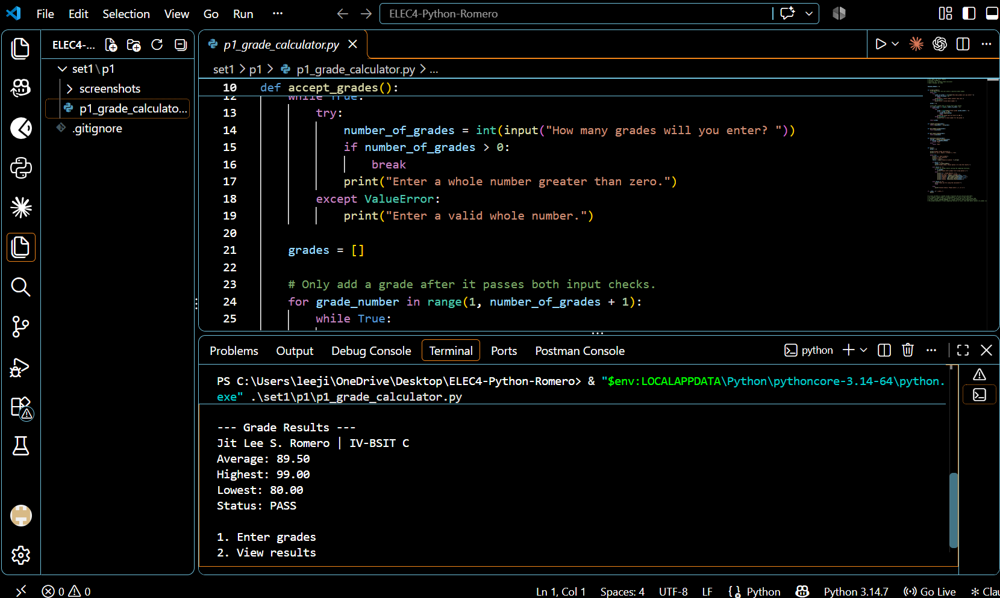
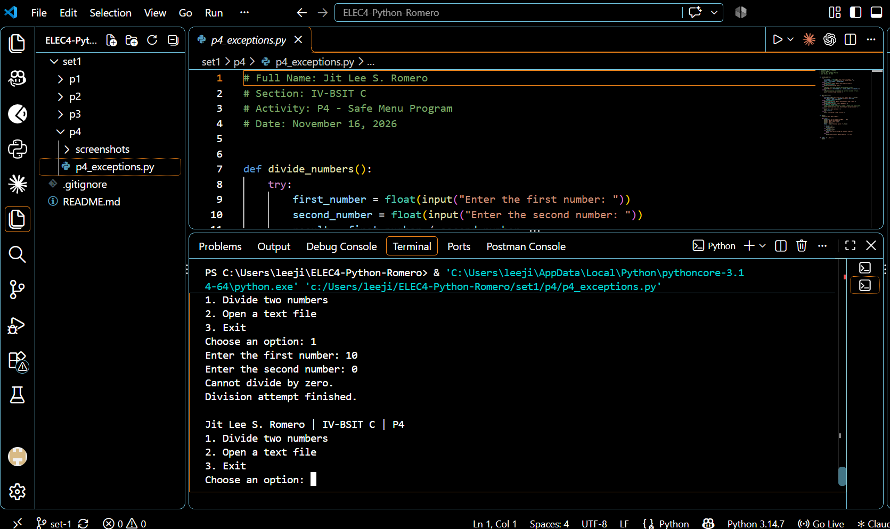
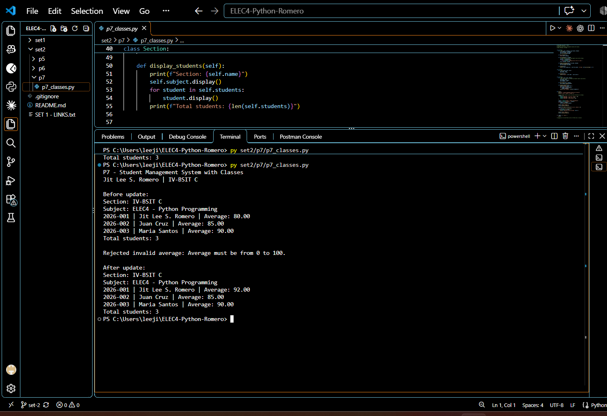
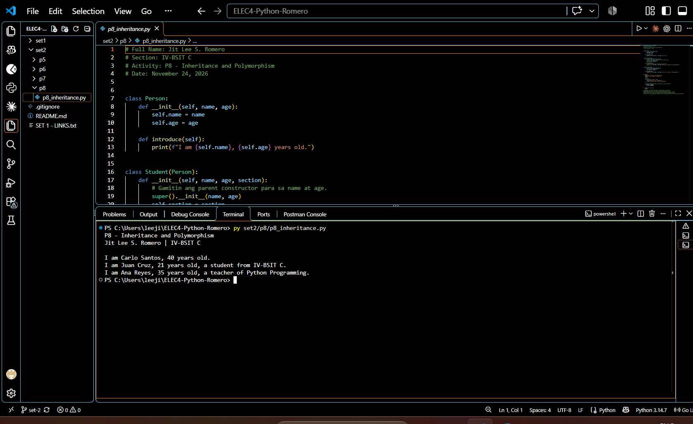

# ELEC 4 - Python Programming

**Name:** Jit Lee S. Romero

**Section:** IV-BSIT C

## Set 1

| Activity | Description | Folder |
| --- | --- | --- |
| P1 - Student Grade Calculator | Computes grade results and pass/fail status. | [P1](set1/p1/) |
| P2 - Custom Module | Uses a custom module to create a grade report. | [P2](set1/p2/) |
| P3 - Student Record Manager | Adds, removes, searches, and lists student names. | [P3](set1/p3/) |
| P4 - Safe Menu Program | Handles invalid numbers, division, and file errors. | [P4](set1/p4/) |

## Set 2

| Activity | Description | Folder |
| --- | --- | --- |
| P5 - Student Information File System | Saves, loads, searches, and updates student records. | [P5](set2/p5/) |
| P6 - Recursion Toolkit | Uses recursion for factorial, Fibonacci, sum, and search. | [P6](set2/p6/) |
| P7 - Student Management System with Classes | Uses related classes to display and update students. | [P7](set2/p7/) |
| P8 - Inheritance and Polymorphism | Uses Person, Student, and Teacher with different introductions. | [P8](set2/p8/) |

## How to Run

Install Python 3. No additional packages are needed. Open a terminal in the repository root and run the command for the activity:

| Activity | Command |
| --- | --- |
| P1 | `py set1/p1/p1_grade_calculator.py` |
| P2 | `py set1/p2/p2_main.py` |
| P3 | `py set1/p3/p3_record_manager.py` |
| P4 | `py set1/p4/p4_exceptions.py` |
| P5 | `py set2/p5/p5_file_system.py` |
| P6 | `py set2/p6/p6_recursion.py` |
| P7 | `py set2/p7/p7_classes.py` |
| P8 | `py set2/p8/p8_inheritance.py` |

On other systems, use `python` or `python3` instead of `py`. Follow the prompts for P1-P6. P7 and P8 run automatically. P5 keeps its records in [students.txt](set2/p5/students.txt).

## Screenshots

### P1

### P2

### P3

### P4

### P5

[Records](set2/p5/screenshots/P5_saved.png) | [Reopened run](set2/p5/screenshots/P5_reopened.png) | [Search](set2/p5/screenshots/P5_search.png)

### P6

### P7

### P8

